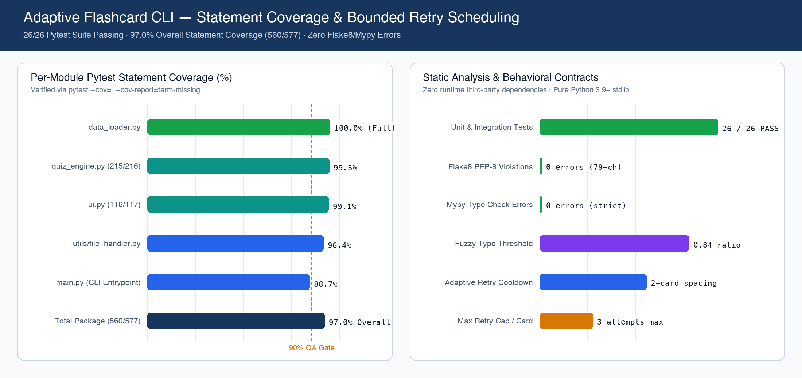
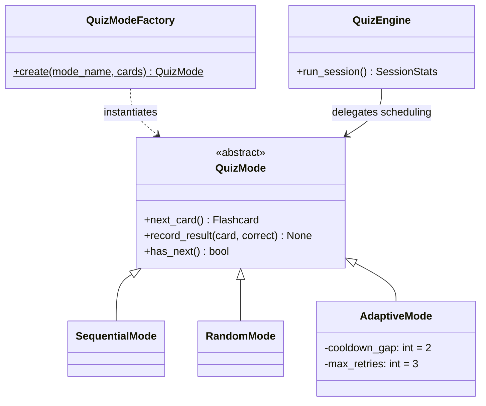

<div align="center">
  
  <br/><br/>
  <p>
    <a href="https://github.com/kenseiAmit/adaptive-flashcard-cli/actions/workflows/ci.yml"></a>
    
    
    
    
    <a href="LICENSE"></a>
  </p>
</div>

---



## Architecture & Strategy Pattern Topology



## Verified QA & Coverage Summary ([`logs/qa_verification_summary.log`](logs/qa_verification_summary.log))

```text
Name                    Stmts   Miss  Cover
-------------------------------------------
data_loader.py             42      0   100%
quiz_engine.py            216      1    99%
ui.py                     117      1    99%
utils/file_handler.py     127      7    94%
main.py                    71      8    89%
-------------------------------------------
TOTAL                     577     17    97%   (26/26 passed in 0.19s | 0 flake8/mypy errors)
```

---

A modular, production-ready Command Line Interface (CLI) learning application built in Python that loads flashcard decks from JSON files and quizzes learners in **Sequential**, **Random**, or **Adaptive** mode.

## Key Features

### Core Capabilities
- **Dual-Format JSON Data Ingestion**: Seamlessly loads flashcards from both JSON array format (`[{"front": "...", "back": "..."}]`, e.g., `data/glossary.json`) and object-wrapper format (`{"cards": [...]}`, e.g., `data/python_basics.json` and `data/software_architecture.json`).
- **Defensive Schema Validation & Error Handling**: Validates every card for non-empty `front` and `back` strings, catching missing files, directories, empty files, and malformed JSON syntax with friendly, actionable error messages (via `FlashcardLoadError`) instead of raw Python tracebacks.
- **Strategy & Factory Design Patterns**:
  - `SequentialMode`: Presents flashcards in sequential order (`1` to `N`).
  - `RandomMode`: Shuffles the deck without mutating the source list.
  - `AdaptiveMode`: Prioritizes and repeats flashcards the learner answers incorrectly using a priority retry queue and spacing cooldown.
  - `QuizModeFactory`: Dynamically instantiates the selected `QuizMode` strategy from the `--mode` CLI flag.
- **Colorized Terminal UI & Session Summary**: Provides immediate ANSI color feedback (Green for correct, Red for incorrect), supports graceful exit via `exit`, `quit`, or `Ctrl+C`, and renders a comprehensive end-of-session summary table showing Total Questions, Correct/Incorrect counts, Accuracy %, Best Streak, Hints Used, Average Time per Card, and a review list of missed terms.

### Extended Features Beyond Basic CRUD
1. **Interactive Progressive Hints (`hint` / `?`)**: Type `hint` or `?` at any question prompt to reveal either a custom card hint or an automatically generated first-letter masked clue (e.g., `A__________ P__________ I________ (3 words, 33 chars)`).
2. **Close-Match Typo Detection**: Uses `difflib.SequenceMatcher` to detect near-miss answers (`>=75%` similarity) and notify the learner how close their response was.
3. **Per-Card Response Timing & Time Limits (`--time-limit`)**: Measures response latency per question, tracks current and best answer streaks, and enforces optional per-question time limits.
4. **Persistent Historical Session Analytics (`--stats` / `--stats-only`)**: Automatically saves completed session summaries and renders an aggregated multi-session performance dashboard (total sessions, overall accuracy, all-time best streak, and most frequently missed terms).
5. **Deck Search, Category Filtering, CLI Card Creation & Missed-Card Export**:
   - Search decks by keyword (`--search`)
   - Filter quiz sessions by category or keyword (`--filter`) and card count (`-n` / `--limit`)
   - Add new cards directly from the CLI (`--add-card FRONT BACK`) preserving deck format
   - Export missed cards from a session to a standalone JSON review deck (`--export-missed`)

---

## Project Structure

```text
adaptive-flashcard-cli/
├── main.py                        # CLI entry point (argparse & workflow dispatch)
├── data_loader.py                 # Public data-loading facade
├── quiz_engine.py                 # Strategy & Factory patterns + QuizEngine & stats
├── ui.py                          # ANSI color formatting, tables & interactive loop
├── utils/
│   ├── __init__.py
│   └── file_handler.py            # Flashcard model, JSON validation, search & I/O
├── data/
│   ├── glossary.json              # Sample deck in Array format (10 cards)
│   ├── python_basics.json         # Sample deck in Object format (8 cards)
│   └── software_architecture.json # Custom deck with hints & categories (5 cards)
├── tests/
│   ├── __init__.py
│   ├── test_flashcard_loader.py   # Unit tests for JSON loading, validation & search
│   ├── test_quiz_modes.py         # Unit tests for Strategy, Factory & AdaptiveMode
│   └── test_integration.py        # End-to-end session & CLI integration tests
├── docs/
│   ├── ai_edit_log.md             # Detailed log of 7 AI collaboration interactions
│   ├── ENGINEERING_REPORT.md         # Final project report (1,000-1,500 words)
│   └── design_patterns.md         # Reference guide for design patterns
├── ai_guidance/                   # Code review checklist & prompting best practices
├── setup.cfg                      # Tooling configuration (pytest, flake8, mypy, coverage)
└── requirements.txt               # Development & quality assurance dependencies
```

---

## Requirements & Setup Instructions

### Prerequisites
- **Python**: Python 3.9 / 3.10 or higher
- **Package Manager**: `pip` and `venv`

### Installation

1. **Navigate to the `starter` directory:**
   ```bash
      ```

2. **Create and activate a virtual environment (recommended for local machines):**
   ```bash
   # macOS / Linux
   python3 -m venv venv
   source venv/bin/activate

   # Windows
   python -m venv venv
   venv\Scripts\activate
   ```

3. **Install dependencies:**
   ```bash
   python -m pip install -r requirements.txt
   ```

---

## Usage Examples

### 1. View All Available CLI Flags
```bash
python main.py --help
```

### 2. Run a Standard Sequential Quiz
```bash
python main.py --mode sequential --file data/glossary.json
```

### 3. Run an Adaptive Quiz (Prioritizes & Repeats Missed Cards)
```bash
python main.py -m adaptive -f data/python_basics.json
```

### 4. Run a Random Quiz with Session & Historical Analytics
```bash
python main.py -m random -f data/software_architecture.json --stats
```

### 5. Filter by Category, Limit Questions, Set a Time Limit, and Export Missed Cards
```bash
python main.py -m adaptive -f data/software_architecture.json \
  --filter "Design Patterns" --limit 3 --time-limit 15 \
  --export-missed data/review_missed.json
```

### 6. Search Flashcards or Add a New Card via CLI
```bash
# Search for a keyword across front, back, and category fields
python main.py -f data/glossary.json --search "Protocol"

# Add a new flashcard to a deck
python main.py -f data/glossary.json \
  --add-card "HTTPS" "Hypertext Transfer Protocol Secure" \
  --category "Security" --hint-text "Encrypted HTTP"

# View cumulative historical performance analytics without starting a quiz
python main.py --stats
```

### Interactive Quiz Commands
While inside a quiz session:
- Type your answer and press **Enter** (comparison is case-insensitive).
- Type `hint` or `?` to reveal a progressive clue for the current card.
- Type `exit` or `quit` (or press `Ctrl+C`) to end the session gracefully and view your summary statistics.

---

## Running Tests & Code Quality Verification

Run the test suite and coverage report (achieves **97% test coverage**, exceeding the >80% requirement):

```bash
python -m pytest tests/
python -m pytest --cov=. --cov-report=html --cov-report=term-missing
```

Run formatting, import sorting, linting, and static type checks:

```bash
python -m black --check .
python -m isort --check --profile black main.py data_loader.py quiz_engine.py ui.py utils tests
python -m flake8 .
python -m mypy .
```
